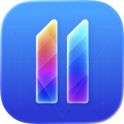
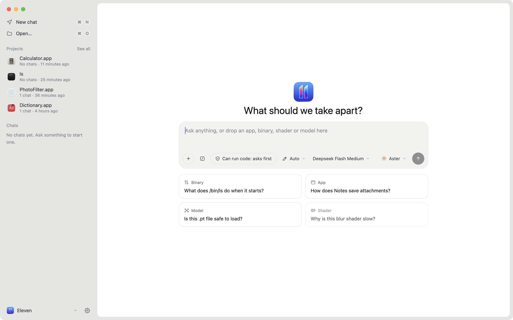

<p align="center">
  <picture>
    <source media="(prefers-color-scheme: dark)" srcset="docs/images/icon-dark.png">
    
  </picture>
</p>

<h1 align="center">Eleven</h1>

<p align="center">An agent-first reverse-engineering app for macOS.</p>

<div align="center">

**English** · [简体中文](README_zh.md) · [繁體中文](README_zh-TW.md) · [日本語](README_ja.md) · [한국어](README_ko.md) · [Türkçe](README_tr.md) · [Русский](README_ru.md) · [Tiếng Việt](README_vi.md) · [ไทย](README_th.md) · [Deutsch](README_de.md) · [Español](README_es.md) · [Français](README_fr.md) · [Українська](README_uk.md) · [Polski](README_pl.md) · [Português (Brasil)](README_pt-BR.md) · [العربية](README_ar.md) · [فارسی](README_fa.md) · [Bahasa Indonesia](README_id.md) · [Italiano](README_it.md)

</div>

<p align="center">
  
</p>

Eleven is a reverse-engineering app built around agents. Drop in an app, a binary, a shader or a model and ask what it does. Any agent that speaks the [Agent Client Protocol](https://agentclientprotocol.com) can read the code, follow references, rename functions, leave notes and suggest patches, while you watch and approve in the same window.

Analysis runs on [Ghidra](https://ghidra-sre.org) through [REA](https://github.com/morluto/rea). The UI is React rendered natively on GPUI by [GPUIX](https://www.npmjs.com/package/@gpuix/react).

## Features

- **Bring your own agent.** Aster, Claude, Codex, Gemini, Cursor, Copilot, OpenCode and any other ACP agent. Run several on the same project, each in its own chat.
- **Agents drive the window.** Eleven serves its own MCP tools so an agent can open a function, switch views, rename, add notes and propose patches.
- **You stay in control.** Every change by you or an agent is logged with its author and can be undone. Byte patches from agents arrive as suggestions you accept or decline.
- **Mach-O, ELF and PE.** Functions, pseudocode, assembly, control-flow graph, cross-references, strings, segments and hex.
- **Projects.** A project is one app or binary. Its chats, renames, bookmarks, notes and patches survive reopening.
- **Patching.** Edit bytes at an address and write a patched copy. The original is never touched.
- **Diffing.** Compare two builds by function and see what changed in the pseudocode.
- **Debugging.** Run a program under LLDB, break on the function you are looking at, step and read locals.
- **Shaders, models and GPU profiles.** Metal shaders and ML model files open in the workbench, linked to the code that loads them. Profile with Instruments.
- **Playbooks.** Built-in skills such as first look, name functions, trace a feature and network map work with any agent.
- **Export.** Pseudocode, assembly and Objective-C class inventories.

## Install

Eleven runs on macOS 14 or later on Apple Silicon.

```sh
curl -fsSL https://raw.githubusercontent.com/Zfinix/eleven/main/install.sh | sh
```

This installs `Eleven.app` into `/Applications`. Builds are not notarized yet, so the installer clears the download quarantine for you.

Eleven also needs:

- **Ghidra 12.x.** Download it from [ghidra-sre.org](https://ghidra-sre.org) and unpack it in `~/.local/share` or `~/Applications`, or set `GHIDRA_INSTALL_DIR`.
- **A JDK, 21 or newer.** `brew install openjdk@21` works. Eleven finds it on its own.
- **An agent.** Pick one on first run. Eleven installs ACP adapters for you when they are needed.

## Build from source

You need [Bun](https://bun.sh), Node 20 or newer, Ghidra and a JDK as above, and a checkout of REA 6.x next to this repo (`../rea`), or `ELEVEN_REA` pointing at one.

```sh
git clone https://github.com/Zfinix/eleven
git clone https://github.com/Zfinix/rea
cd eleven/app
bun install
bun run dev
```

| Command | What it does |
| --- | --- |
| `bun run dev [file]` | Runs the app with hot reload, optionally opening a file |
| `bunx tsc --noEmit --noUnusedLocals` | Typechecks the app, tests and scripts |
| `./script/test` | Runs the test suite one file at a time |
| `./script/bundle-macos` | Builds `build/Eleven.app` |
| `./script/package` | Builds, signs and zips a release |

## Environment

All of these are optional. Eleven finds the usual install spots on its own.

| Variable | Use |
| --- | --- |
| `GHIDRA_INSTALL_DIR` | Ghidra install to use |
| `JAVA_HOME` | JDK to run Ghidra with |
| `ELEVEN_REA` | REA to use instead of the bundled one |
| `ELEVEN_LLDB_DAP` | `lldb-dap` for the debugger |
| `ELEVEN_SUPPORT` | Where Eleven keeps projects and settings |
| `ELEVEN_SIGN_IDENTITY` | Code-signing identity for `./script/package` |

## Documentation

- [MCP tools](docs/mcp-tools.md): every tool agents get in Eleven, what each one takes and returns, permissions and privacy.
- [Skills](docs/skills.md): the built-in playbooks and how to write your own.

## Repository

- `app/` is the app: React and TypeScript on GPUIX.
- `crates/` is an earlier Rust prototype, kept for reference. The app does not use it.
- `launch/` is the launch video, made with Remotion.
- `install.sh` is the installer.

See [AGENTS.md](AGENTS.md) for how the code is laid out and the rules it follows.

## License

Eleven is released under the [Apache License 2.0](LICENSE). Bundled third-party code is listed in [THIRD_PARTY_NOTICES.md](THIRD_PARTY_NOTICES.md). Agent logos belong to their owners and appear only to identify those agents.
